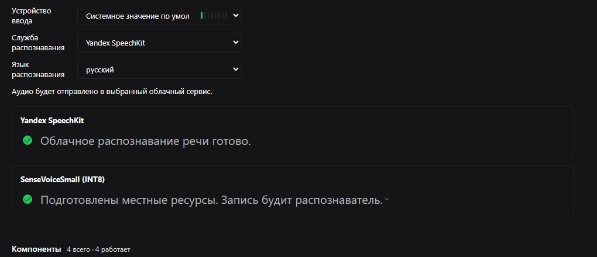

# dsh-speech-to-text-yandex

Yandex SpeechKit speech recognition for DSH Web **Voice input**: it registers the cloud
provider `yandex-speechkit`, so the built-in microphone transcribes speech with Yandex
instead of the local SenseVoice model. For DSH Web users who already have a Yandex Cloud
account.

| | |
|---|---|
| **Platform** | DSH Web profile (`web`), host-side plugin — the microphone UI is the stock Voice input |
| **DSH** | `>=0.2.2-rc.1 <0.3.0-0` |
| **Install** | GitHub release tarball (see [Install guide](../docs/install.md)) |
| **License** | MIT |



## The problem

DSH Web Voice input ships with a local SenseVoice recognizer: the first use requires
preparing local resources, and recognition runs on the host. A Yandex Cloud user who
already pays for SpeechKit has no way to pick it in the recognition-service list.
This package adds the missing provider, so the stock microphone keeps working exactly
as before — only the recognition backend changes.

## What it does

- Registers `yandex-speechkit` in DSH's speech-to-text service, so it appears under
  Voice input → Recognition service; the bundled patch makes it the default provider
  with language `ru`.
- Sends the finished recording to Yandex SpeechKit REST v1 and inserts the recognized
  text into the message draft.
- Splits recordings longer than 28 seconds at quiet boundaries — the quietest 100 ms
  window in the 3 seconds before the cut — and joins the chunk texts in order.
- Needs no prepared resources: the provider is `ready` immediately and the settings
  page shows “Cloud speech recognition is ready”.
- Deliberately does not run a local model, does not stream audio, and does not add
  punctuation or timings (REST v1 returns plain text).

## Install

Install from the GitHub release tarball — there is no npm package and no npm
account is needed:

```powershell
dsh plugin --profile web add "https://github.com/Feskel2/dsh-extras/releases/download/v1.1.0/dsh-speech-to-text-yandex.tgz"
```

Then restart `dsh web` (host plugins are loaded at boot) and open the URL it prints.
The provider is inserted and selected automatically; you can verify it in
Plugins → Voice input.

Step-by-step instructions, updates, removal and troubleshooting:
**[Install guide](../docs/install.md)**.

### Requirements

- DSH `>=0.2.2-rc.1 <0.3.0-0` and Node.js `>=24.9.0`, profile `web`.
- pnpm on `PATH` (`dsh plugin` forwards package operations to pnpm).
- The experimental **Voice input** bundle enabled (Plugins → Voice input). This package
  only registers a recognition service; the microphone UI belongs to that bundle.
- Yandex Cloud: a service account with the role `ai.speechkit-stt.user` on the folder,
  plus either an API key or an IAM token for that account.
- Outbound HTTPS to `stt.api.cloud.yandex.net`. The plugin uses the normal Node.js
  proxy environment variables (e.g. `HTTPS_PROXY`) of the `dsh web` process.

## Configure

Credentials are read from `plugin-config.json` next to the plugin's `index.mjs`; with a
normal `dsh plugin add` install that is
`~/.dsh/profiles/web/node_modules/dsh-speech-to-text-yandex/plugin-config.json`.
The file is re-read on every request: change the key and the next recording uses it,
no restart needed.

Precedence: `cordis.patch.yml` config → environment variables → `plugin-config.json` →
built-in defaults.

For the full Yandex Cloud walkthrough — billing, folder, service account, roles, API-key
scopes, verification, logs and troubleshooting — see
[Yandex SpeechKit setup](https://github.com/Feskel2/dsh-extras/blob/main/docs/yandex-speechkit-setup.md).

### Environment variables

Environment variables are read once, when `dsh web` starts, so restart it after changing
them. Empty fields in `plugin-config.json` fall back to the environment.

| Variable | Meaning |
|---|---|
| `YANDEX_STT_API_KEY` | API key of the service account (`Authorization: Api-Key …`). |
| `YANDEX_STT_IAM_TOKEN` | IAM token (`Authorization: Bearer …`); takes precedence over the API key. |
| `YANDEX_STT_FOLDER_ID` | Folder ID; sent only in IAM mode. |

`YANDEX_SPEECHKIT_API_KEY`, `YANDEX_SPEECHKIT_IAM_TOKEN`,
`YANDEX_SPEECHKIT_FOLDER_ID` and the short aliases `YC_API_KEY`, `YC_IAM_TOKEN`,
`YC_FOLDER_ID` are accepted for compatibility.

### Configuration file

Copy `plugin-config.example.json` to `plugin-config.json` next to `index.mjs` and fill in
**either** `apiKey` **or** `iamToken` + `folderId`. The `folderId` is only needed with an
IAM token; in API-key mode SpeechKit takes the folder from the service account.

```json
{
  "apiKey": "<your-api-key>",
  "folderId": "",
  "iamToken": "",
  "endpoint": "https://stt.api.cloud.yandex.net/speech/v1/stt:recognize",
  "topic": "general",
  "profanityFilter": false,
  "rawResults": false,
  "chunkSeconds": 25,
  "searchBackSeconds": 3,
  "requestTimeoutMs": 45000,
  "maxAttempts": 3,
  "debug": false,
  "logFile": ".state/events.log"
}
```

Keep this file out of version control — only the example with empty credentials belongs
in a repository. The plugin never logs the key or the token.

### Fields

| Field | Default | Meaning |
|---|---|---|
| `apiKey` | — | Service-account API key. |
| `iamToken` | — | IAM token; takes precedence over `apiKey`. |
| `folderId` | — | Folder ID; only used in IAM mode. |
| `endpoint` | `https://stt.api.cloud.yandex.net/speech/v1/stt:recognize` | SpeechKit STT endpoint. |
| `topic` | `general` | Language model: `general`, `general:rc`, `general:deprecated`. |
| `profanityFilter` | `false` | SpeechKit profanity filter. |
| `rawResults` | `false` | `false` — numbers as digits; `true` — numbers as words. |
| `chunkSeconds` | `25` | Target chunk size; the plugin caps a chunk at 28 s / 900 KiB (API limit is 30 s / 1 MiB). |
| `searchBackSeconds` | `3` | How far before the cut the quiet window is searched. |
| `requestTimeoutMs` | `45000` | Timeout of one HTTP request. |
| `maxAttempts` | `3` | Attempts per chunk on 429/5xx/timeout (400/401/403 are not retried). |
| `maxAudioSeconds` | `600` | Guard: a longer recording is rejected. |
| `debug` | `true` (`false` in the example) | Write events to the log file. |
| `logFile` | `.state/events.log` | Log path, relative to the package directory. |

Any field can also be pinned in the profile's `cordis.patch.yml` (highest priority):

```yaml
- id: speech-to-text-yandex
  name: dsh-speech-to-text-yandex
  config:
    chunkSeconds: 20
```

### Languages

The UI sends short codes, the plugin maps them to SpeechKit codes:

| UI | SpeechKit |
|---|---|
| `ru` | `ru-RU` |
| `en` | `en-US` |
| `de`, `fr`, `es`, `it`, `pl`, `tr`, `kk`, `uz`, `he`, `nl`, `fi`, `sv` | `de-DE`, `fr-FR`, `es-ES`, `it-IT`, `pl-PL`, `tr-TR`, `kk-KZ`, `uz-UZ`, `he-IL`, `nl-NL`, `fi-FI`, `sv-SE` |
| `pt` / `pt-br` | `pt-PT` / `pt-BR` |
| `auto` | `auto` — SpeechKit language auto-detection |

The selection is stored in the `speech-to-text` entry of the profile's
`cordis.patch.yml` through the Settings UI.

## How it works

```text
Voice input (browser) ── WAV 16 kHz mono PCM16 ──> speechToText service
      └─> yandex-speechkit provider (this package)
            ├─ parse RIFF chunks, require PCM16 mono 16 kHz, strip the header
            ├─ split >28 s at the quietest 100 ms window near the boundary
            ├─ POST raw PCM to SpeechKit REST v1 (Api-Key / Bearer + folderId)
            └─ join chunk texts with a space ──> message draft
```

1. The browser hands over a canonical WAV (16 kHz, mono, PCM16) and a language code.
2. The plugin parses the RIFF chunks (not “skip 44 bytes”), validates the format, extracts
   the `data` chunk and computes the duration.
3. Short audio goes out as one request; longer audio is split into chunks of at most 28 s
   and 900 KiB, with each cut moved to the quietest spot within the search window.
4. Chunks are sent sequentially as a `POST` of raw PCM with
   `Authorization: Api-Key …` (or `Bearer …` plus `folderId`) and
   `?lang=…&format=lpcm&sampleRateHertz=16000&topic=…`.
5. The returned texts are joined and whitespace-normalized.
6. `400`/`401`/`403` are reported immediately with a hint (key, role, format);
   `429`/`5xx`/timeouts are retried with exponential backoff.

## Limitations (honest list)

- **Paid:** every request is billed by Yandex Cloud at SpeechKit rates; the plugin adds no
  free tier and does not cache audio.
- **Cloud:** the recording leaves the machine and is sent to Yandex.
- SpeechKit REST v1 returns text without punctuation and with a capital first letter —
  that is the service's behaviour, not the plugin's.
- No streaming: DSH sends the recording after you stop the microphone, so latency equals
  the request time.
- Recordings longer than 28 seconds are cut; the boundary is placed in a pause, but
  SpeechKit can still distort one short word at the seam. Dictating in 20–25 second
  pieces is more accurate for long monologues.
- `auto` language detection works, but can be wrong on noise or mixed languages; pick a
  concrete language for stable results.
- Recordings longer than `maxAudioSeconds` (600 s by default) are rejected before any
  network call.
- A proxy is respected only through the `dsh web` process environment, not through a
  system proxy configured elsewhere.

## Security

- The plugin runs inside the `dsh web` process and makes one kind of network call: an
  HTTPS `POST` to the configured SpeechKit endpoint (default
  `https://stt.api.cloud.yandex.net/speech/v1/stt:recognize`).
- The request carries the raw PCM audio (WAV header removed) and the authorization header
  (`Api-Key …` or `Bearer …`). Nothing else leaves the machine.
- Credentials come from the environment or from `plugin-config.json`; they are never
  written to the log. The example file in this package has empty credential fields.
- `.state/events.log` contains metadata only: activation, provider registration and
  `transcribe.ok` / `transcribe.error` with audio duration, chunk count, latency, text
  length and HTTP status. No audio, no recognized text, no keys.
- No telemetry, no analytics.

## Uninstall

```sh
dsh plugin --profile web remove dsh-speech-to-text-yandex
```

Everything the plugin writes (the optional `plugin-config.json` and
`.state/events.log`) lives inside the package directory, so it goes away with the
package. Restart `dsh web`; the stock SenseVoice provider stays available in Voice input.

## Development

```sh
node --test test/smoke.mjs                      # 28 tests on a local mock server, no network
node test/live.mjs path/to/recording.wav ru     # real SpeechKit request, needs credentials
npm pack --dry-run
```

The smoke suite covers WAV parsing, chunk splitting, text stitching, the HTTP contract,
retries and cancellation. The live test needs a real API key and network access.

## License

MIT — see [LICENSE](LICENSE).
