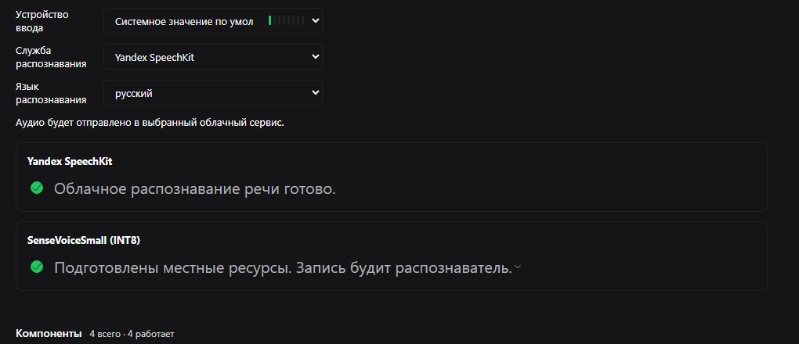

# dsh-speech-to-text-yandex

Распознавание речи через Yandex SpeechKit для **Voice input** в DSH Web: плагин
регистрирует облачный провайдер `yandex-speechkit`, и встроенный микрофон
распознаёт речь через Yandex вместо локальной модели SenseVoice. Для тех, у кого
уже есть аккаунт Yandex Cloud.

**Установка (профиль `web`):**
`dsh plugin --profile web add "https://github.com/Feskel2/dsh-extras/releases/download/v1.1.0/dsh-speech-to-text-yandex.tgz"` · [Инструкция по установке](../docs/install.ru.md)

| | |
|---|---|
| **Платформа** | DSH Web, профиль `web`; плагин host-стороны, микрофонный интерфейс — штатный Voice input |
| **DSH** | `>=0.2.2-rc.1 <0.3.0-0` |
| **Установка** | Tarball GitHub-релиза (см. [инструкцию](../docs/install.ru.md)) |
| **Лицензия** | MIT |



## Зачем это

В DSH Web Voice input по умолчанию распознаёт речь локально моделью SenseVoice:
для первого запуска нужно подготовить локальные ресурсы, и распознавание идёт на
хосте. Если вы уже платите за Yandex SpeechKit, выбрать его в списке служб
распознавания было нельзя. Этот пакет добавляет недостающий провайдер: штатный
микрофон работает как раньше, меняется только сервис распознавания.

## Что делает

- Регистрирует `yandex-speechkit` в сервисе распознавания DSH — он появляется в
  Voice input → «Служба распознавания»; patch-файл пакета делает его провайдером по
  умолчанию с языком `ru`.
- Отправляет готовую запись в Yandex SpeechKit REST v1 и вставляет распознанный
  текст в черновик сообщения.
- Режет записи длиннее 28 секунд по тихим участкам — самое тихое окно 100 мс в
  пределах 3 секунд перед границей — и склеивает тексты кусков по порядку.
- Не требует подготовки ресурсов: провайдер сразу в состоянии `ready`, на странице
  настроек написано «Облачное распознавание речи готово».
- Сознательно не запускает локальную модель, не делает потокового распознавания и
  не добавляет пунктуацию и таймкоды — REST v1 возвращает обычный текст.

## Требования

- DSH `>=0.2.2-rc.1 <0.3.0-0` и Node.js `>=24.9.0`, профиль `web`.
- pnpm в `PATH` (`dsh plugin` передаёт операции с пакетами в pnpm).
- Включённый экспериментальный bundle **Voice input** (Плагины → Голосовой ввод).
  Пакет регистрирует только службу распознавания; микрофонный интерфейс — часть
  этого bundle.
- Yandex Cloud: сервисный аккаунт с ролью `ai.speechkit-stt.user` на каталог и
  API-ключ либо IAM-токен этого аккаунта.
- Исходящий HTTPS к `stt.api.cloud.yandex.net`. Плагин учитывает обычные переменные
  окружения прокси процесса `dsh web` (например, `HTTPS_PROXY`).

## Установка

Установите tarball из GitHub-релиза — npm-пакета нет, аккаунт npm не нужен:

```powershell
dsh plugin --profile web add "https://github.com/Feskel2/dsh-extras/releases/download/v1.1.0/dsh-speech-to-text-yandex.tgz"
```

Затем перезапустите `dsh web` (host-плагины загружаются при старте) и откройте
напечатанный адрес. Провайдер вставляется и выбирается автоматически; проверить
можно в Плагинах → Голосовой ввод.

Пошаговая инструкция, обновление, удаление и разбор ошибок:
**[Инструкция по установке](../docs/install.ru.md)**.

## Настройка

Доступы читаются из `plugin-config.json` рядом с `index.mjs` плагина; при обычной
установке через `dsh plugin add` это
`~/.dsh/profiles/web/node_modules/dsh-speech-to-text-yandex/plugin-config.json`.
Файл перечитывается на каждый запрос: поменяли ключ — следующая запись уже
использует новый, перезапуск не нужен.

Приоритет: config в `cordis.patch.yml` → переменные окружения →
`plugin-config.json` → встроенные значения по умолчанию.

Полный разбор облачной части Яндекса — биллинг, каталог, сервисный аккаунт, роли,
области действия API-ключа, проверка, журналы и ошибки — в гайде
[«Настройка Yandex SpeechKit»](https://github.com/Feskel2/dsh-extras/blob/main/docs/yandex-speechkit-setup.ru.md).

### Переменные окружения

Переменные читаются один раз при старте `dsh web` — после изменения перезапустите
его. Пустые поля в `plugin-config.json` заменяются значениями из окружения.

| Переменная | Смысл |
|---|---|
| `YANDEX_STT_API_KEY` | API-ключ сервисного аккаунта (`Authorization: Api-Key …`). |
| `YANDEX_STT_IAM_TOKEN` | IAM-токен (`Authorization: Bearer …`); приоритетнее API-ключа. |
| `YANDEX_STT_FOLDER_ID` | Идентификатор каталога; передаётся только в режиме IAM. |

Для совместимости принимаются `YANDEX_SPEECHKIT_API_KEY`,
`YANDEX_SPEECHKIT_IAM_TOKEN`, `YANDEX_SPEECHKIT_FOLDER_ID` и короткие алиасы
`YC_API_KEY`, `YC_IAM_TOKEN`, `YC_FOLDER_ID`.

### Файл конфигурации

Скопируйте `plugin-config.example.json` в `plugin-config.json` рядом с `index.mjs` и
заполните **либо** `apiKey`, **либо** `iamToken` + `folderId`. `folderId` нужен
только при авторизации IAM-токеном; при API-ключе SpeechKit берёт каталог из
сервисного аккаунта.

```json
{
  "apiKey": "<ваш-api-ключ>",
  "folderId": "",
  "iamToken": "",
  "endpoint": "https://stt.api.cloud.yandex.net/speech/v1/stt:recognize",
  "topic": "general",
  "profanityFilter": false,
  "rawResults": false,
  "chunkSeconds": 25,
  "searchBackSeconds": 3,
  "requestTimeoutMs": 45000,
  "maxAttempts": 3,
  "debug": false,
  "logFile": ".state/events.log"
}
```

Файл с ключом не должен попадать в репозиторий — в репозитории лежит только пример
с пустыми полями. Плагин не пишет ключ и токен в журнал.

### Поля

| Поле | По умолчанию | Смысл |
|---|---|---|
| `apiKey` | — | API-ключ сервисного аккаунта. |
| `iamToken` | — | IAM-токен; приоритетнее `apiKey`. |
| `folderId` | — | Каталог; используется только в режиме IAM. |
| `endpoint` | `https://stt.api.cloud.yandex.net/speech/v1/stt:recognize` | Endpoint SpeechKit STT. |
| `topic` | `general` | Языковая модель: `general`, `general:rc`, `general:deprecated`. |
| `profanityFilter` | `false` | Мат-фильтр SpeechKit. |
| `rawResults` | `false` | `false` — числа цифрами; `true` — прописью. |
| `chunkSeconds` | `25` | Целевой размер куска; плагин ограничивает кусок 28 с / 900 КиБ (предел API — 30 с / 1 МиБ). |
| `searchBackSeconds` | `3` | Насколько раньше границы искать тихое окно. |
| `requestTimeoutMs` | `45000` | Таймаут одного HTTP-запроса. |
| `maxAttempts` | `3` | Попытки на кусок при 429/5xx/таймауте (400/401/403 не ретраятся). |
| `maxAudioSeconds` | `600` | Предохранитель: более длинная запись отклоняется. |
| `debug` | `true` (в примере `false`) | Писать события в журнал. |
| `logFile` | `.state/events.log` | Путь журнала относительно каталога пакета. |

Любое поле можно закрепить в `cordis.patch.yml` профиля (высший приоритет):

```yaml
- id: speech-to-text-yandex
  name: dsh-speech-to-text-yandex
  config:
    chunkSeconds: 20
```

### Языки

UI присылает короткие коды, плагин переводит их в коды SpeechKit:

| UI | SpeechKit |
|---|---|
| `ru` | `ru-RU` |
| `en` | `en-US` |
| `de`, `fr`, `es`, `it`, `pl`, `tr`, `kk`, `uz`, `he`, `nl`, `fi`, `sv` | `de-DE`, `fr-FR`, `es-ES`, `it-IT`, `pl-PL`, `tr-TR`, `kk-KZ`, `uz-UZ`, `he-IL`, `nl-NL`, `fi-FI`, `sv-SE` |
| `pt` / `pt-br` | `pt-PT` / `pt-BR` |
| `auto` | `auto` — автоопределение языка SpeechKit |

Выбор сохраняется в записи `speech-to-text` файла `cordis.patch.yml` профиля через
интерфейс настроек.

## Как это работает

```text
Voice input (браузер) ── WAV 16 кГц mono PCM16 ──> сервис speechToText
      └─> провайдер yandex-speechkit (этот пакет)
            ├─ разбор RIFF-чанков, проверка PCM16 mono 16 кГц, вырезание заголовка
            ├─ нарезка >28 с по самому тихому окну 100 мс у границы
            ├─ POST сырого PCM в SpeechKit REST v1 (Api-Key / Bearer + folderId)
            └─ склейка текстов кусков через пробел ──> черновик сообщения
```

1. Браузер отдаёт канонический WAV (16 кГц, mono, PCM16) и код языка.
2. Плагин разбирает RIFF по чанкам (а не «минус 44 байта»), проверяет формат,
   вырезает `data` и считает длительность.
3. Короткое аудио уходит одним запросом; длинное режется на куски не больше 28 с и
   900 КиБ, граница сдвигается в самое тихое место окна поиска.
4. Куски отправляются последовательно: `POST` сырого PCM с
   `Authorization: Api-Key …` (или `Bearer …` и `folderId`) и
   `?lang=…&format=lpcm&sampleRateHertz=16000&topic=…`.
5. Полученные тексты склеиваются и нормализуются по пробелам.
6. `400`/`401`/`403` показываются сразу с подсказкой (ключ, роль, формат);
   `429`/`5xx`/таймауты повторяются с экспоненциальной паузой.

## Ограничения

- **Платно:** каждый запрос тарифицируется Yandex Cloud по ценам SpeechKit; своих
  бесплатных квот и кэша аудио плагин не добавляет.
- **Облако:** запись покидает машину и уходит в Yandex.
- SpeechKit REST v1 возвращает текст без пунктуации и с заглавной буквой в начале —
  это поведение сервиса, а не плагина.
- Нет потокового распознавания: DSH отправляет запись после остановки микрофона,
  поэтому задержка равна времени запроса.
- Записи длиннее 28 секунд режутся; граница ищется в паузе, но на стыке SpeechKit
  всё равно может исказить одно короткое слово. Длинные монологи точнее диктовать
  частями по 20–25 секунд.
- Автоопределение языка (`auto`) работает, но может ошибиться при шуме или смеси
  языков; для стабильности выбирайте конкретный язык.
- Записи длиннее `maxAudioSeconds` (по умолчанию 600 с) отклоняются до обращения к
  сети.
- Прокси учитывается только через переменные окружения процесса `dsh web`, а не
  через системные настройки прокси.

## Безопасность

- Плагин работает внутри процесса `dsh web` и делает сетевые запросы только одного
  вида: HTTPS `POST` на настроенный endpoint SpeechKit (по умолчанию
  `https://stt.api.cloud.yandex.net/speech/v1/stt:recognize`).
- В запросе уходят сырой PCM (без WAV-заголовка) и заголовок авторизации
  (`Api-Key …` или `Bearer …`). Больше ничего с машины не уходит.
- Доступы берутся из окружения или `plugin-config.json` и никогда не пишутся в
  журнал. В примере конфигурации в этом пакете поля доступов пустые.
- `.state/events.log` содержит только метаданные: активацию, регистрацию провайдера
  и `transcribe.ok` / `transcribe.error` с длительностью аудио, числом кусков,
  временем ответа, длиной текста и HTTP-статусом. Ни аудио, ни распознанного текста,
  ни ключей там нет.
- Никакой телеметрии и аналитики.

## Удаление

```sh
dsh plugin --profile web remove dsh-speech-to-text-yandex
```

Всё, что пишет плагин (необязательный `plugin-config.json` и `.state/events.log`),
лежит в каталоге пакета и удаляется вместе с ним. Перезапустите `dsh web`; локальный
провайдер SenseVoice остаётся доступен в Voice input.

## Разработка

```sh
node --test test/smoke.mjs                      # 28 тестов на локальном мок-сервере, без сети
node test/live.mjs путь/к/записи.wav ru         # реальный запрос в SpeechKit, нужны доступы
npm pack --dry-run
```

Smoke-набор проверяет разбор WAV, нарезку, склейку текста, HTTP-контракт, ретраи и
отмену. Живому тесту нужны настоящий ключ и сеть.

## Лицензия

MIT — см. [LICENSE](LICENSE).
