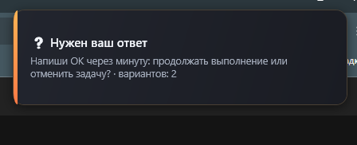
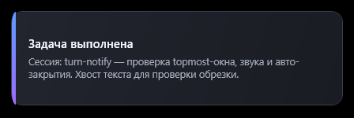
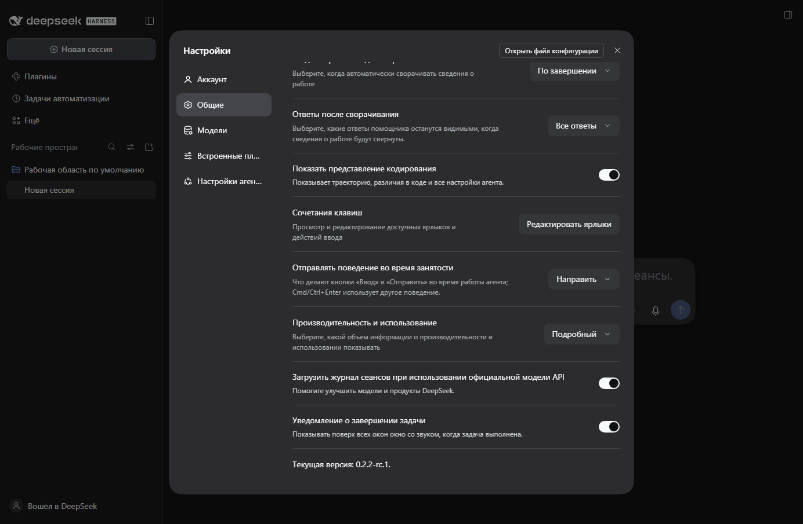

# dsh-topmost-notify

A native always-on-top notification with a chime when a DSH Web task finishes — or when the agent is waiting for your answer. Windows only.

| | |
|---|---|
| **Platform** | Windows 10/11 · DSH Web profile |
| **DSH** | `>=0.2.2-rc.1 <0.3.0-0` |
| **Node.js** | `>=24.9.0` (DSH requirement) |
| **Install** | `dsh plugin --profile web add dsh-topmost-notify` |
| **License** | MIT |



## The problem

A turn can run for minutes while you work in another application, watch a fullscreen video or play a game. A browser tab cannot draw above another application, and the DSH tab may be minimised or inactive. Missing the moment a task ends means either waiting idly or coming back too late.

## What it does

- When a top-level chat finishes a turn (`turn/end` with `reason.kind === completed`), a native WPF card appears in the top-right corner with the chat title and one line of the final answer, plays a short bundled WAV chime, and closes itself after about one second. It does not steal focus.
- When the agent calls `ask_user_question`, an amber "answer needed" card shows the question and how many options it has, so you know the chat is waiting for you.
- Settings → General has the master toggle; a 🔔/🔕 bell in the chat header mutes notifications for that chat only and is persisted in the profile.
- It deliberately does not queue notifications, cannot be clicked, and stays silent for subagent turns (unless the diagnostics flag is on) — it is a signal, not a dialog.



## Install

```sh
dsh plugin --profile web add dsh-topmost-notify
```

Then restart `dsh web` (profile UI plugins are loaded at boot) and open the URL it prints. The toggle appears in Settings → General.

### Requirements

- DSH `0.2.2-rc.1` or newer in the `0.2.x` line, profile `web`;
- Windows 10/11 with Windows PowerShell 5.1 (included in the system);
- Node.js ≥ 24.9.0 (DSH's own requirement);
- no account, no API key, no network access.

## Configure

| Setting | Default | Meaning |
|---|---|---|
| `enabled` | `true` | Master switch; the same value as the Settings → General row |
| `durationMs` | `1000` | How long the card stays on screen, in ms (300–10000) |
| `sound` | `true` | Play the bundled WAV chime |
| `showSessionTitle` | `true` | Put the chat title on the card |
| `showAnswerExcerpt` | `true` | Put one flattened line of the final answer on the card |
| `mutedSessions` | `[]` | Chats muted by the header bell (written by the UI) |
| `notifySubagentTest` | `false` | Diagnostics: also notify for subagent turns |

The toggle is edited in the UI; the other fields live next to the plugin row in the profile's `cordis.patch.yml`:

```yaml
- id: topmost-notify
  name: dsh-topmost-notify
  config:
    durationMs: 1500
    sound: false
```



Settings changes are applied without restarting the host. Updated plugin code is only picked up after restarting `dsh web`.

## How it works

```text
turn/end (reason=completed, top-level chat)
        │
        ├─ host half (index.mjs): chat title + one-line answer excerpt
        │
        └─ powershell.exe -File host/notify.ps1 -PayloadBase64 <json>
                    ├─ WPF window: Topmost, ShowActivated=false, auto-close
                    └─ SoundPlayer: host/chime.wav (when the card appears)
```

There is no resident helper process: every notification is a short-lived `powershell.exe` (Windows PowerShell 5.1) running `host/notify.ps1` from the package. The payload is a base64-encoded JSON with title, body, duration, sound flag and kind. The script builds the window in code, sets `Topmost`, keeps `ShowActivated=false`, starts the chime when the window is loaded, and runs a dispatcher loop until the close timer fires. Spawning is fire-and-forget: a helper failure is logged and never propagates into the session.

## Limitations (honest list)

- Windows 10/11 only; the card is WPF, not an HTML overlay.
- The card appears **~1.7–2.5 s** after the turn ends (typically ~2 s): a cold `powershell.exe` start (~0.7 s) plus WPF initialisation (~0.8–1.2 s). A resident helper would be faster; it is deliberately not used.
- Exclusive fullscreen (old DirectX exclusive mode, some players) can cover a topmost window. Borderless/windowed fullscreen, the normal desktop and browser video are fine.
- Fixed position (top-right, 24 px margin). Several notifications in a row overlap; there is no queue.
- The card is not interactive: no buttons and no way to click through to the chat. It also does not take focus.
- Subagent turns are silent by design (prevents delegation spam). A top-level turn in any chat — including background and scheduled sessions — does notify.
- The built-in card captions are Russian today; the chat title and answer excerpt are whatever your chat contains.
- After installing or updating, restart `dsh web`: new `insert` rows and new ESM code are loaded at boot.

## Security

- The only executable it starts is `powershell.exe` (Windows PowerShell 5.1) with `host/notify.ps1` from this package, `-NoProfile -NonInteractive -WindowStyle Hidden -ExecutionPolicy Bypass` (the bypass applies to this single invocation). The payload is a base64 JSON argument parsed inside the script.
- No network requests, no telemetry, no update checks, no credentials, no environment secrets. The WAV sounds are read from the package.
- Diagnostics: one line per decision is appended to `host/notify-debug.log` next to the installed script (capped at ~256 KiB, truncated on the next write). It contains session ids, the chat title/answer excerpt and the payload — local only. Delete the file at any time.

## Uninstall

```sh
dsh plugin --profile web remove dsh-topmost-notify
```

The package folder (including `host/notify-debug.log`) is removed with it. If you added a `- id: topmost-notify` block to the profile patch by hand, remove that block too.

## Manual install (repository checkout only)

The npm package is the supported route. In a repository checkout there is also `install.ps1`, which copies the package into the profile and adds the same patch row; it is not part of the published tarball.

## Development

From a repository checkout:

```sh
node test/index-smoke.mjs
node test/client-smoke.mjs
npm pack --dry-run
```

The host test imports `@deepseek-ai/schemastery`: it locates the installed DSH tree automatically, or you can set `DSH_NODE_MODULES` to that tree's `node_modules` directory. Test files and `artifacts/` are not published.

## History

The plugin started as a local package named `turn-notify`; the npm name is `dsh-topmost-notify` because `dsh-turn-notify` was already taken.

## License

MIT — see [LICENSE](LICENSE).
