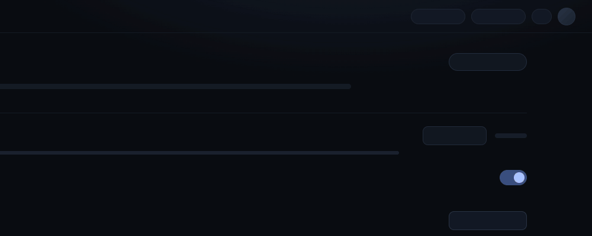
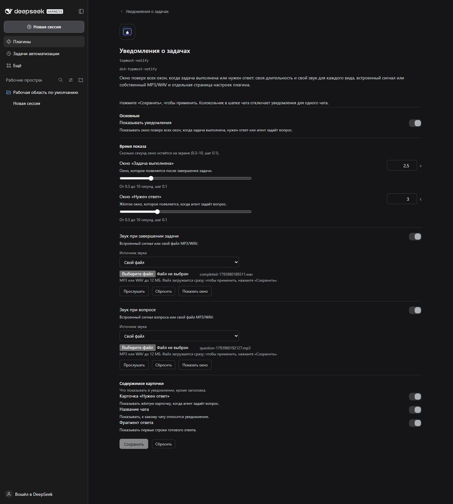

# dsh-topmost-notify

A native always-on-top notification with a chime when a DSH Web task finishes — or when the agent is waiting for your answer. Windows only.

**Install:** `dsh plugin --profile web add "https://github.com/Feskel2/dsh-extras/releases/download/v1.1.0/dsh-topmost-notify.tgz"` · [Install guide](../docs/install.md) · Windows only

| | |
|---|---|
| **Platform** | Windows 10/11 · DSH Web profile |
| **DSH** | `>=0.2.2-rc.1 <0.3.0-0` |
| **Node.js** | `>=24.9.0` (DSH requirement) |
| **Install** | GitHub release tarball (see [Install guide](../docs/install.md)) |
| **License** | MIT |




## The problem

A turn can run for minutes while you work in another application, watch a fullscreen video or play a game. A browser tab cannot draw above another application, and the DSH tab may be minimised or inactive. Missing the moment a task ends means either waiting idly or coming back too late.

## What it does

- When a top-level chat finishes a turn (`turn/end` with `reason.kind === completed`), a native WPF card appears in the top-right corner with the chat title and one line of the final answer, plays a short bundled WAV chime, and closes itself after about one second. It does not steal focus.
- When the agent calls `ask_user_question`, an amber "answer needed" card shows the question and how many options it has, so you know the chat is waiting for you.
- Settings → General has the master toggle; a 🔔/🔕 bell in the chat header mutes notifications for that chat only and is persisted in the profile.
- The plugin has its own settings page: **Plugins → Task notifications → row `topmost-notify` → chevron**. There you set the display time for each card type separately (completed / answer needed) and the sound per type: the bundled chime or any of your own **MP3/WAV** files, with "Listen" and "Show a sample window" buttons.
- It deliberately does not queue notifications, cannot be clicked, and stays silent for subagent turns (unless the diagnostics flag is on) — it is a signal, not a dialog.


## Install

Install from the GitHub release tarball — there is no npm package and no npm
account is needed:

```powershell
dsh plugin --profile web add "https://github.com/Feskel2/dsh-extras/releases/download/v1.1.0/dsh-topmost-notify.tgz"
```

The command adds the package to the `web` profile as a **bundle** (adds it to
`package.json → dsh.profile.bundles`), so the plugin gets its own card and
settings page under **Plugins**.

Then restart `dsh web` (profile UI plugins are loaded at boot) and open the URL
it prints. The toggle appears in Settings → General, and the plugin gets its own
page under **Plugins**. The restart is required once: new bundle rows and host
code are not hot-loaded.

If you are working from a repository checkout, `install.ps1` is an alternative
that copies the package into the profile, removes the older local `turn-notify`
layout if it exists, and keeps your custom sounds in `sounds/`:

```powershell
powershell -ExecutionPolicy Bypass -File .\dsh-topmost-notify\install.ps1
```

Updating replaces the package directory. Back up any custom MP3/WAV files from
`sounds/` before an update and upload them again afterwards; the timing and
sound settings themselves live in the profile configuration and survive.
Step-by-step instructions, updates, removal and troubleshooting:
**[Install guide](../docs/install.md)**.

### Requirements

- DSH `0.2.2-rc.1` or newer in the `0.2.x` line, profile `web`;
- Windows 10/11 with Windows PowerShell 5.1 (included in the system);
- Node.js ≥ 24.9.0 (DSH's own requirement);
- pnpm on `PATH` (`dsh plugin` forwards package operations to pnpm);
- no account, no API key, no network access.

## Configure

| Setting | Default | Meaning |
|---|---|---|
| `enabled` | `true` | Master switch; the same value as the Settings → General row |
| `durationMs` | `1000` | How long the "task finished" card stays on screen, in ms (300–10000) |
| `questionDurationMs` | `1500` | How long the "answer needed" card stays on screen, in ms (300–10000) |
| `sound` | `true` | Legacy master sound switch, used only when a per-kind field is absent |
| `completedSoundEnabled` | `true` | Play a sound when a task finishes |
| `questionSoundEnabled` | `true` | Play a sound when the agent asks a question |
| `completedSoundFile` | `''` | Absolute path to your own `.mp3`/`.wav`; empty = bundled `chime.wav` |
| `questionSoundFile` | `''` | Absolute path to your own `.mp3`/`.wav`; empty = bundled `chime-question.wav` |
| `showSessionTitle` | `true` | Put the chat title on the card |
| `showAnswerExcerpt` | `true` | Put one flattened line of the final answer on the card |
| `notifyQuestions` | `true` | Show the amber "answer needed" card when the agent asks a question |
| `mutedSessions` | `[]` | Chats muted by the header bell (written by the UI) |
| `notifySubagentTest` | `false` | Diagnostics: also notify for subagent turns |

Everything above is edited on the plugin's own page: **Plugins → Task notifications →
row `topmost-notify` → chevron**. Durations are shown in seconds; a sound file is
uploaded straight from the page (`.mp3` or `.wav`, up to 12 MiB) and previewed
with "Listen" or "Show a sample window" before saving. The Settings → General
toggle and the chat bell stay as quick controls for `enabled` / `mutedSessions`.



The same values can still be written by hand next to the plugin row in the
profile's `cordis.patch.yml`:

```yaml
- id: topmost-notify
  name: dsh-topmost-notify
  config:
    durationMs: 1500
    sound: false
```


Settings changes are applied without restarting the host. Updated plugin code is only picked up after restarting `dsh web`.

## How it works

```text
turn/end (reason=completed, top-level chat)
        │
        ├─ host half (index.mjs): chat title + one-line answer excerpt,
        │  per-kind duration and sound file
        │
        └─ powershell.exe -File host/notify.ps1 -PayloadBase64 <json>
                    ├─ WPF window: Topmost, ShowActivated=false, auto-close
                    ├─ WAV  → SoundPlayer   (bundled chime or your .wav)
                    └─ MP3  → WPF MediaPlayer (your .mp3)
```

There is no resident helper process: every notification is a short-lived `powershell.exe` (Windows PowerShell 5.1) running `host/notify.ps1` from the package. The payload is a base64-encoded JSON with title, body, duration, sound (boolean or an absolute file path) and kind. The script builds the window in code, sets `Topmost`, keeps `ShowActivated=false`, starts the sound when the window is loaded, and runs a dispatcher loop until the close timer fires. Spawning is fire-and-forget: a helper failure is logged and never propagates into the session.

The settings page talks to a tiny local HTTP API of the plugin (`/dsh-topmost-notify`): `status`, sound upload, sounds reset, window preview and sound preview. Uploaded files are stored in `sounds/` beside the installed host module; they are local and never sent anywhere. An `install.ps1` reinstall keeps them; a `dsh plugin remove` + `add` update replaces the package directory, so back them up first.

## Limitations (honest list)

- Windows 10/11 only; the card is WPF, not an HTML overlay.
- The card appears **~1.7–2.5 s** after the turn ends (typically ~2 s): a cold `powershell.exe` start (~0.7 s) plus WPF initialisation (~0.8–1.2 s). A resident helper would be faster; it is deliberately not used.
- Exclusive fullscreen (old DirectX exclusive mode, some players) can cover a topmost window. Borderless/windowed fullscreen, the normal desktop and browser video are fine.
- Fixed position (top-right, 24 px margin). Several notifications in a row overlap; there is no queue.
- The card is not interactive: no buttons and no way to click through to the chat. It also does not take focus.
- Subagent turns are silent by design (prevents delegation spam). A top-level turn in any chat — including background and scheduled sessions — does notify.
- The built-in card captions are Russian today; the chat title and answer excerpt are whatever your chat contains.
- Your own sound is played in full (up to ~20 s); the bundled chime keeps the short 350 ms tail after the card closes. MP3 playback needs Windows Media codecs (present on normal Windows 10/11).
- Uploading stores one custom sound per kind (completed / question); a new upload replaces the previous file of that kind.
- After installing or updating, restart `dsh web`: new bundle rows and new ESM code are loaded at boot. Settings changes do not need a restart.

## Security

- The only executable it starts is `powershell.exe` (Windows PowerShell 5.1) with `host/notify.ps1` from this package, `-NoProfile -NonInteractive -WindowStyle Hidden -ExecutionPolicy Bypass` (the bypass applies to this single invocation). The payload is a base64 JSON argument parsed inside the script.
- No network requests, no telemetry, no update checks, no credentials, no environment secrets. Sounds are read from the package (`host/*.wav`) or from the `sounds/` folder the settings page writes, and no path outside these two folders can be played through the HTTP API.
- The settings server accepts only `.mp3`/`.wav` uploads (extension and file signature checked), at most 12 MiB, and writes them only into the plugin's own `sounds/` folder. It listens only on the local DSH Web server you already run.
- Diagnostics: one line per decision is appended to `host/notify-debug.log` next to the installed script (capped at ~256 KiB, truncated on the next write). It contains session ids, the chat title/answer excerpt and the payload — local only. Delete the file at any time.

## Uninstall

```powershell
dsh plugin --profile web remove dsh-topmost-notify
```

From a repository checkout you can also run
`powershell -ExecutionPolicy Bypass -File .\dsh-topmost-notify\install.ps1 -Uninstall`.

The package folder (including `host/notify-debug.log` and your uploaded sounds) is removed with it. If you added a `- id: topmost-notify` config block to the profile patch by hand, remove that block too.

## Development

From a repository checkout:

```sh
node test/index-smoke.mjs
node test/host-api.test.mjs
node test/client-smoke.mjs
npm pack --dry-run
```

The host test imports `@deepseek-ai/schemastery`: it locates the installed DSH tree automatically, or you can set `DSH_NODE_MODULES` to that tree's `node_modules` directory. Test files and `artifacts/` are not published.

## History

The plugin started as a local package named `turn-notify`; the npm name is `dsh-topmost-notify` because `dsh-turn-notify` was already taken.

## License

MIT — see [LICENSE](LICENSE).
