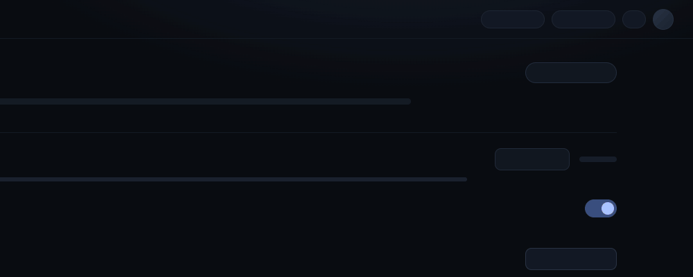
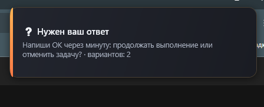
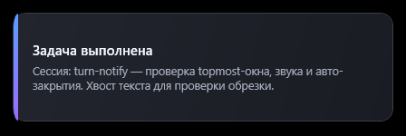
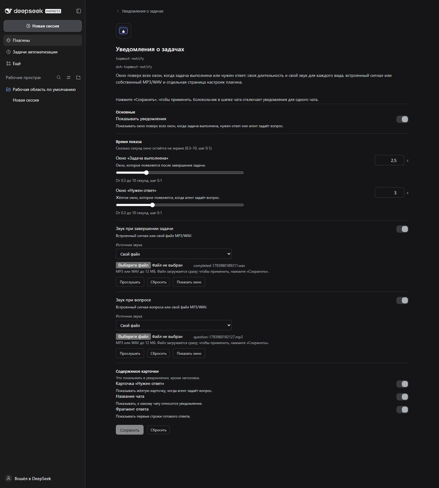
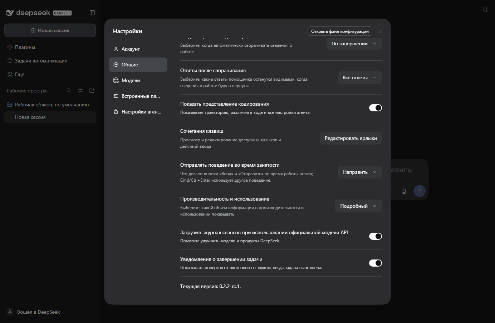

# dsh-topmost-notify

Нативное окно поверх всех окон со звуком: когда задача в DSH Web завершена — или когда агент ждёт ответа. Только Windows.

**Установка:** `dsh plugin --profile web add "https://github.com/Feskel2/dsh-extras/releases/download/v1.1.0/dsh-topmost-notify.tgz"` · [Инструкция по установке](../docs/install.ru.md) · только Windows

| | |
|---|---|
| **Платформа** | Windows 10/11 · профиль DSH Web |
| **DSH** | `>=0.2.2-rc.1 <0.3.0-0` |
| **Node.js** | `>=24.9.0` (требование DSH) |
| **Установка** | Tarball GitHub-релиза (см. [инструкцию](../docs/install.ru.md)) |
| **Лицензия** | MIT |





## Зачем это

Ход агента может идти минутами, пока вы работаете в другом приложении, смотрите видео на весь экран или играете. Вкладка браузера не может рисовать поверх другого приложения, а вкладка DSH в этот момент может быть свёрнута или неактивна. Если пропустить момент завершения, придётся либо ждать впустую, либо вернуться слишком поздно.

## Что делает

- Когда верхнеуровневый чат завершает ход (`turn/end` с `reason.kind === completed`), в правом верхнем углу появляется нативная карточка WPF с названием чата и одной строкой финального ответа, играет короткий встроенный WAV-звук, и примерно через секунду карточка закрывается сама. Фокус она не забирает.
- Когда агент вызывает `ask_user_question`, появляется янтарная карточка «нужен ответ» с текстом вопроса и числом вариантов — видно, что чат ждёт вас.
- В Settings → General есть главный тумблер; колокольчик 🔔/🔕 в шапке чата отключает уведомления только для этого чата и сохраняется в профиле.
- У плагина есть **своя страница настроек**: **Плагины → «Уведомления о задачах» → строка `topmost-notify` → шеврон**. Там раздельно настраиваются время показа окна «задача выполнена» и «нужен ответ», а также звук для каждого вида: встроенный сигнал или **любой свой файл MP3/WAV** — с кнопками «Прослушать» и «Показать окно».
- Сознательно не ставит уведомления в очередь, не реагирует на клик и по умолчанию молчит о ходах сабагентов (кроме диагностического флага) — это сигнал, а не диалог.



## Установка

Установите tarball из GitHub-релиза — npm-пакета нет, аккаунт npm не нужен:

```powershell
dsh plugin --profile web add "https://github.com/Feskel2/dsh-extras/releases/download/v1.1.0/dsh-topmost-notify.tgz"
```

Команда добавляет пакет в профиль `web` как **бандл** (запись в
`package.json → dsh.profile.bundles`), поэтому у плагина появляется своя
карточка и страница настроек в «Плагинах».

Затем перезапустите `dsh web` (UI-плагины профиля загружаются при старте) и
откройте напечатанный URL. Тумблер появится в Settings → General, а у плагина
будет своя страница в «Плагинах». Перезапуск нужен один раз: новые строки
бандла и host-код на лету не подхватываются.

Если вы работаете из клона репозитория, альтернатива — `install.ps1`: он
копирует пакет в профиль, убирает прежнюю локальную раскладку `turn-notify`,
если она осталась, и сохраняет ваши звуки в `sounds/`.

```powershell
powershell -ExecutionPolicy Bypass -File .\dsh-topmost-notify\install.ps1
```

Обновление заменяет каталог пакета. Перед обновлением сохраните свои MP3/WAV из
`sounds/` и загрузите их заново после установки; сами настройки длительности и
звука лежат в конфигурации профиля и переживают обновление.
Пошаговая инструкция, обновление, удаление и разбор ошибок:
**[Инструкция по установке](../docs/install.ru.md)**.

### Требования

- DSH `0.2.2-rc.1` или новее в линии `0.2.x`, профиль `web`;
- Windows 10/11 с Windows PowerShell 5.1 (есть в системе);
- Node.js ≥ 24.9.0 (требование самого DSH);
- pnpm в `PATH` (`dsh plugin` передаёт операции с пакетами в pnpm);
- аккаунт, API-ключ и сеть не нужны.

## Настройка

| Поле | По умолчанию | Смысл |
|---|---|---|
| `enabled` | `true` | Главный выключатель; то же значение, что у тумблера в Settings → General |
| `durationMs` | `1000` | Сколько миллисекунд висит окно «задача выполнена» (300–10000) |
| `questionDurationMs` | `1500` | Сколько миллисекунд висит окно «нужен ответ» (300–10000) |
| `sound` | `true` | Легаси-мастер звука; применяется, только если поле вида не задано |
| `completedSoundEnabled` | `true` | Звук при завершении задачи |
| `questionSoundEnabled` | `true` | Звук при вопросе агента |
| `completedSoundFile` | `''` | Абсолютный путь к своему `.mp3`/`.wav`; пусто = встроенный `chime.wav` |
| `questionSoundFile` | `''` | Абсолютный путь к своему `.mp3`/`.wav`; пусто = встроенный `chime-question.wav` |
| `showSessionTitle` | `true` | Показывать название чата на карточке |
| `showAnswerExcerpt` | `true` | Показывать одну строку финального ответа |
| `notifyQuestions` | `true` | Показывать янтарную карточку «нужен ответ», когда агент задаёт вопрос |
| `mutedSessions` | `[]` | Чаты, отключённые колокольчиком (пишет UI) |
| `notifySubagentTest` | `false` | Диагностика: уведомлять и о ходах сабагентов |

Всё это правится на собственной странице плагина: **Плагины → «Уведомления о
задачах» → строка `topmost-notify` → шеврон**. Время показывается в секундах,
звук загружается прямо со страницы (`.mp3` или `.wav`, до 12 МиБ) и проверяется
кнопками «Прослушать» / «Показать окно» ещё до сохранения. Тумблер в Settings →
General и колокольчик в шапке чата остаются быстрыми переключателями
`enabled` / `mutedSessions`.



Те же значения по-прежнему можно прописать вручную рядом со строкой плагина в
`cordis.patch.yml` профиля:

```yaml
- id: topmost-notify
  name: dsh-topmost-notify
  config:
    durationMs: 1500
    sound: false
```



Изменения настроек применяются без перезапуска хоста. Новый код плагина подхватывается только после перезапуска `dsh web`.

## Как работает

```text
turn/end (reason=completed, верхнеуровневый чат)
        │
        ├─ host-половина (index.mjs): название чата + строка ответа,
        │  длительность и звук своего вида
        │
        └─ powershell.exe -File host/notify.ps1 -PayloadBase64 <json>
                    ├─ окно WPF: Topmost, ShowActivated=false, автозакрытие
                    ├─ WAV  → SoundPlayer   (встроенный сигнал или свой .wav)
                    └─ MP3  → WPF MediaPlayer (свой .mp3)
```

Резидентного процесса нет: каждое уведомление — короткоживущий `powershell.exe` (Windows PowerShell 5.1), который запускает `host/notify.ps1` из пакета. Payload — base64 от JSON с заголовком, текстом, длительностью, звуком (флаг или абсолютный путь к файлу) и видом. Скрипт строит окно кодом, выставляет `Topmost`, оставляет `ShowActivated=false`, запускает звук при загрузке окна и крутит цикл сообщений до срабатывания таймера закрытия. Запуск fire-and-forget: сбой хелпера пишется в лог и никогда не попадает в сессию.

Страница настроек общается с небольшим локальным HTTP API плагина (`/dsh-topmost-notify`): статус, загрузка звука, сброс звука, показ образца окна и прослушивание звука. Загруженные файлы лежат в `sounds/` рядом с установленным host-модулем и никуда не отправляются. Переустановка через `install.ps1` их сохраняет; обновление через `dsh plugin remove` + `add` заменяет каталог пакета, поэтому звуки нужно сохранить заранее.

## Ограничения (честный список)

- Только Windows 10/11; карточка — WPF, а не HTML-оверлей.
- Карточка появляется через **~1,7–2,5 с** после завершения хода (обычно ~2 с): холодный старт `powershell.exe` (~0,7 с) плюс инициализация WPF (~0,8–1,2 с). Резидентный хелпер был бы быстрее, но от него сознательно отказались.
- Эксклюзивный fullscreen (старый DirectX exclusive mode, некоторые плееры) может перекрыть topmost-окно. Borderless/windowed fullscreen, обычный рабочий стол и видео в браузере — в порядке.
- Позиция фиксированная (правый верхний угол, отступ 24 px). Несколько уведомлений подряд перекрывают друг друга; очереди нет.
- Карточка неинтерактивна: кнопок нет, кликнуть и перейти в чат нельзя. Фокус она не забирает.
- Ходы сабагентов молчат по замыслу (чтобы не было спама от делегирования). Ход верхнего уровня в любом чате — включая фоновые и запланированные сессии — уведомляет.
- Встроенные подписи карточки сейчас на русском; название чата и строка ответа — те, что есть в чате.
- Свой звук проигрывается целиком (не дольше ~20 с); у встроенного сигнала остаётся прежний хвост 350 мс после закрытия карточки. Для MP3 нужны кодеки Windows Media (в обычной Windows 10/11 есть).
- Для каждого вида хранится один свой звук (completed / question); новая загрузка заменяет файл этого вида.
- После установки или обновления перезапустите `dsh web`: новые строки бандла и новый ESM-код загружаются при старте. Изменения настроек перезапуска не требуют.

## Безопасность

- Единственный запускаемый процесс — `powershell.exe` (Windows PowerShell 5.1) со скриптом `host/notify.ps1` из этого пакета, с `-NoProfile -NonInteractive -WindowStyle Hidden -ExecutionPolicy Bypass` (bypass действует только на этот запуск). Payload передаётся base64-JSON в аргументе и разбирается внутри скрипта.
- Сетевых запросов, телеметрии, проверок обновлений, ключей и секретов окружения нет. Звуки читаются из пакета (`host/*.wav`) или из папки `sounds/`, которую пишет страница настроек; проиграть через HTTP API путь вне этих двух папок нельзя.
- Сервер настроек принимает только `.mp3`/`.wav` (проверяются расширение и сигнатура файла), не больше 12 МиБ, и пишет только в собственную папку `sounds/`. Слушает он только тот локальный DSH Web, который вы уже запускаете.
- Диагностика: по одной строке на каждое решение в `host/notify-debug.log` рядом с установленным скриптом (ограничение ~256 КиБ, обрезается при следующей записи). Там id сессий, название чата/фрагмент ответа и payload — только локально. Файл можно удалить в любой момент.

## Удаление

```powershell
dsh plugin --profile web remove dsh-topmost-notify
```

Из клона репозитория можно также выполнить
`powershell -ExecutionPolicy Bypass -File .\dsh-topmost-notify\install.ps1 -Uninstall`.

Папка пакета (вместе с `host/notify-debug.log` и загруженными звуками) удаляется. Если вы вручную добавляли блок `- id: topmost-notify` в патч профиля, удалите и его.

## Разработка

Из репозитория:

```sh
node test/index-smoke.mjs
node test/host-api.test.mjs
node test/client-smoke.mjs
npm pack --dry-run
```

Host-тест импортирует `@deepseek-ai/schemastery`: установленное дерево DSH находится автоматически, либо укажите его каталог `node_modules` в `DSH_NODE_MODULES`. Тесты и `artifacts/` не публикуются.

## История

Плагин начинался как локальный пакет `turn-notify`; npm-имя — `dsh-topmost-notify`, потому что `dsh-turn-notify` уже занято.

## Лицензия

MIT — см. [LICENSE](LICENSE).
