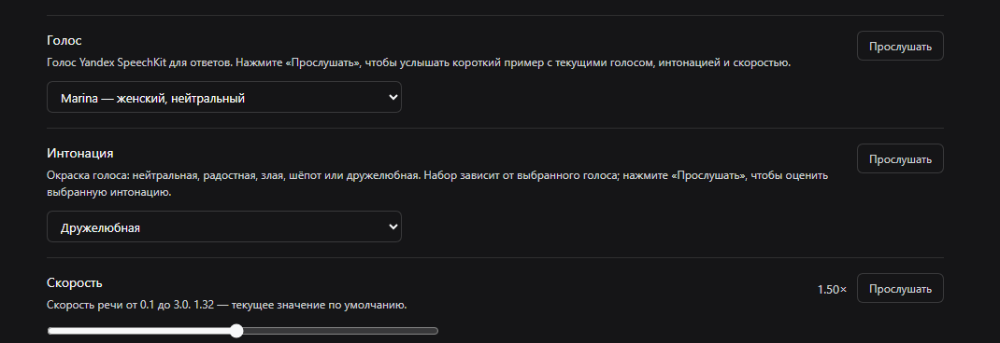
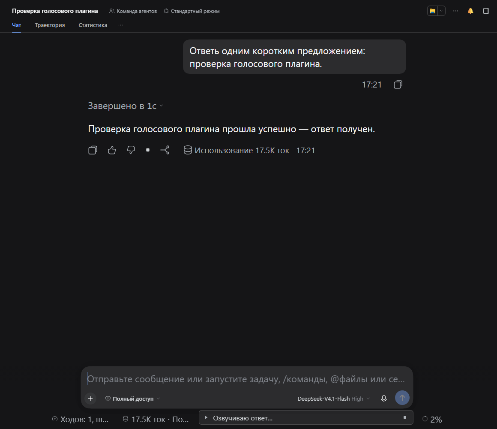
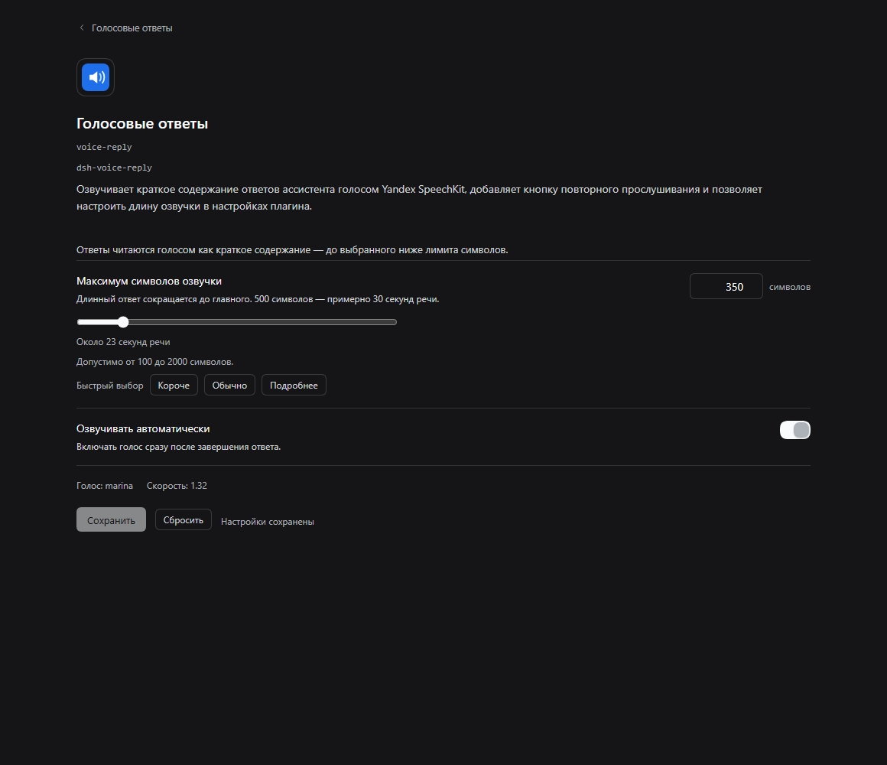

# dsh-voice-reply

Reads the assistant's finished answers aloud in DSH Web with Yandex SpeechKit TTS — and puts a 🔊 replay button on every answer.

**Install (profile `web`):** `dsh plugin --profile web add "https://github.com/Feskel2/dsh-extras/releases/download/v1.1.0/dsh-voice-reply.tgz"` · [Install guide](../docs/install.md)

| | |
|---|---|
| **Platform** | DSH Web (`web` profile); tested on Windows 11 |
| **DSH** | `>=0.2.2-rc.1 <0.3.0-0` |
| **Install** | GitHub release tarball (see [Install guide](../docs/install.md)) |
| **License** | MIT |





## The problem

The agent works for a while and then answers with a wall of text. You want to hear the result while doing something else, without copying the answer into a separate speech service and without clicking "read" on every message. Browser speech synthesis sounds robotic; a hosted TTS voice sounds natural but needs credentials, caching and a player wired into the chat.

## What it does

- When a turn finishes, the host turns the answer into a short **spoken summary** (extractive, computed locally — no model call), synthesizes it with **Yandex SpeechKit TTS** and the browser plays it automatically.
- The spoken budget is the user-facing setting: **500 characters by default** (about 30 seconds), adjustable from 100 to 2000. A long answer is reduced to its key sentences instead of being read for minutes.
- Every finalized answer gets a **🔊 speaker button** in the action strip: click to replay, click again to stop. Replays are served from the on-disk audio cache, so they do not call Yandex (or bill you) again.
- A small chip above the composer shows the state while audio is prepared or played (e.g. "reading the brief summary…") and has a stop button. Errors and the browser's autoplay block are reported there too.
- **Settings → General → "Read answers aloud"** is the `autoSpeak` switch. The plugin's own settings page (**Plugins → Voice replies → Configure**) edits the spoken-summary budget, the Yandex voice, the voice **intonation**, the speech speed and `autoSpeak`; a **Preview** button plays a short sample with the current draft voice, intonation and speed before you save. The intonation dropdown always offers exactly the intonations the selected voice supports, and voices without intonations say so.
- History is not re-read: only answers that finish while the plugin is installed are spoken, and only new turns trigger automatic speech; the 🔈 button still works on any answer.
- Deliberately does **not** listen to the microphone, transcribe audio, or send your chat anywhere except the short text it synthesizes.

## Install

Install from the GitHub release tarball — there is no npm package and no npm
account is needed:

```powershell
dsh plugin --profile web add "https://github.com/Feskel2/dsh-extras/releases/download/v1.1.0/dsh-voice-reply.tgz"
```

Then restart `dsh web` — profile UI plugins are loaded at boot — and open the URL it prints. The bundle row is added by `cordis.patch.yml`, so no manual profile edit is needed.

Updating replaces the package directory, including `plugin-config.json` with your Yandex key and settings. Copy that file out before `remove` and put it back after `add`; see the [Install guide](../docs/install.md#7-update-a-plugin).

### Requirements

- DSH `>=0.2.2-rc.1` with the `web` profile, Node.js `>=24.9.0` (the DSH requirement);
- pnpm on `PATH` (`dsh plugin` forwards package operations to pnpm);
- a **Yandex Cloud** account with a service account that has the role **`ai.speechkit-tts.user`** on the folder and an **API key scoped `yc.ai.speechkitTts.execute`** (or an IAM token plus folder id);
- outbound HTTPS to `tts.api.cloud.yandex.net`;
- a browser that can play audio (the first automatic playback may require one page interaction because of the autoplay policy).

## Configure

| Setting | Default | Meaning |
|---|---|---|
| `enabled` | `true` | Master switch for the whole plugin |
| `autoSpeak` | `true` | Speak new answers automatically (Settings → General and the plugin settings page) |
| `summaryMaxChars` | `500` | Maximum characters of the spoken summary (100–2000, step 50) |
| `maxChars` | `4000` | Legacy hard cap on the source answer before summarization |
| `voice` | `marina` | Yandex TTS v1 voice (see the list below; editable on the plugin settings page) |
| `emotion` | `''` | Optional Yandex intonation (`neutral`, `good`, `evil`, `friendly`, `whisper`); the available set depends on the voice, and an empty value means the voice default. Editable on the plugin settings page |
| `speed` | `1.32` | Speech rate, 0.1–3.0 (editable on the plugin settings page) |
| `format` | `mp3` | `mp3`, `oggopus` or `lpcm` |
| `debug` | `true` | Accepted for compatibility; this build writes `.state/events.log` regardless (counts, timings and status codes only) |
| `endpoint` | `https://tts.api.cloud.yandex.net/speech/v1/tts:synthesize` | SpeechKit TTS endpoint |

The Settings → General row and the plugin settings page write through the host (`POST /dsh-voice-reply/preferences`) and apply immediately, without editing the profile or restarting `dsh web`. The plugin settings page also saves `voice`, `emotion` and `speed` there, so a choice made in the UI wins over the patch row.



Settings can also live in the `config` block of the plugin row:

```yaml
- id: voice-reply
  name: dsh-voice-reply
  config:
    voice: marina
    summaryMaxChars: 500
```

### Credentials

The key is **never** stored in the repository. Two local sources are supported, and the environment wins over the file:

| Variable | Meaning |
|---|---|
| `YANDEX_TTS_API_KEY` | SpeechKit API key (service-account mode) |
| `YANDEX_TTS_IAM_TOKEN` | IAM token (IAM mode; requires a folder id) |
| `YANDEX_TTS_FOLDER_ID` | Folder id, used with an IAM token |

Or put the same fields in a local `plugin-config.json` next to the plugin (copy `plugin-config.example.json`). The host **re-reads that file on every request**, so replacing the key does not need a `dsh web` restart; environment variables are read by the running process and therefore need a restart to change.

To create the key in [Yandex Cloud](https://console.yandex.cloud) (full walkthrough:
[Yandex SpeechKit setup](../docs/yandex-speechkit-setup.md)):

1. Give the service account the role **`ai.speechkit-tts.user`** on the folder.
2. Create an **API key** for that account with the scope **`yc.ai.speechkitTts.execute`** (or leave the scope empty so the key inherits the account's rights).
3. Put the key into `YANDEX_TTS_API_KEY` or `plugin-config.json`.

A key created only for speech recognition (`yc.ai.speechkitStt.execute`) is rejected by TTS with `401 UNAUTHORIZED` / `Permission denied` — issue a TTS-scoped key. After a role change, Yandex may take a few minutes to propagate the new permission; a single `401` right after the change is normal.

## How it works

```text
turn ends (reason = completed)
      │
      ├─ host: remember the finished answer for this chat (one pending answer)
      │
      └─ browser (only while the chat is focused):
            claim the answer once → POST /dsh-voice-reply/speak
                 │  host: local extractive summary (≤ summaryMaxChars)
                 │        → Yandex SpeechKit TTS v1 (sequential chunks)
                 │        → audio cached on disk by voice|emotion|speed|format|lang|text
                 └─ <audio> plays sequentially; 🔊 replays from the cache
```

- Host routes: `GET /dsh-voice-reply/status`, `POST /dsh-voice-reply/speak`, `POST /dsh-voice-reply/preview`, `POST /dsh-voice-reply/preferences`, `GET /dsh-voice-reply/audio/<file>`; the "one answer per chat" store is a separate row (`dsh-voice-reply/pending`, routes under `/dsh-voice-pending`).
- The plugin settings page previews a draft voice/intonation/speed through `/preview`: the host synthesizes a short language-appropriate sample with those drafts and the browser plays it through the same player. Preview audio is cached like answer audio, so replaying the same sample costs nothing.
- The pending answer is claimed atomically: switching chats, reloading the page or opening a second tab cannot start the same answer twice.
- A long answer is split into chunks that satisfy SpeechKit's 5000-character and 15 KB URL-encoded body limits (Cyrillic expands about 6× when encoded).
- `429`/`5xx`/timeouts are retried with backoff; `400`/`401`/`403` are not retried and are shown with an actionable hint.
- Auto-speak is deferred while the tab is hidden or unfocused; it starts when you return to that chat, so the plugin does not talk in the background.

## Limitations

- **Paid service.** Yandex SpeechKit TTS is billed by Yandex Cloud according to its tariffs for every uncached synthesis. The plugin itself is free; cached replays cost nothing.
- **A summary, not the full answer.** Only the extracted key sentences are spoken (default 500 characters, 100–2000). Code blocks, tables and links are skipped; the full text stays on screen.
- SpeechKit **v1 voices only** — `alena`, `filipp`, `ermil`, `jane`, `omazh`, `zahar`, `marina`, `madi_ru`, `amira`, `madi`, `nigora`, `john`, `lea`. The v3 voices (`dasha`, `julia`, `lera`, `masha`, …) and v3 SSML are not available through this API.
- **Intonations are voice-specific.** Only Russian voices expose them (`alena`, `ermil`, `jane`, `omazh`, `zahar`: neutral + good/evil; `marina`: neutral, whisper, friendly); the other v1 voices always sound neutral. Changing the voice keeps an intonation only when the new voice supports it, and an unsupported value is never sent to Yandex.
- Browser autoplay policy can block the first automatic playback until you interact with the page; the chip then asks you to press 🔊.
- History is not re-read automatically; answers finished before installation have no host record and speak only when you press 🔊.
- Speech is generated sequentially (one TTS call at a time), so a long summary may take a few seconds before the first sound.
- The plugin reads the answer text; it does not record audio, translate, or recognize speech.

## Security

- The host makes HTTPS requests **only to the configured SpeechKit endpoint** (default `https://tts.api.cloud.yandex.net/speech/v1/tts:synthesize`). There is no telemetry, no analytics, no external logging and no other outbound host.
- The API key/IAM token stays in the host process: it is never sent to the browser, never written to logs and never included in the npm package. Only `plugin-config.example.json` with empty credential fields ships.
- The spoken summary is computed locally with no model call. Only that short text is sent to Yandex for synthesis; the rest of the answer stays on your machine.
- `.state/events.log` contains character counts, timings and status codes only — never answer text, never secrets.
- Audio is cached in the OS temp directory (`dsh-voice-reply-cache`), not in the repository.
- `plugin-config.json` is git-ignored; keep it local.

## Uninstall

```sh
dsh plugin --profile web remove dsh-voice-reply
```

The audio cache in the OS temp directory (`dsh-voice-reply-cache`) and `.state/events.log` inside the plugin folder remain on disk; delete them manually if you want a clean removal.

## Development

The runtime has no dependencies and no build step. Local tests (no network, mock SpeechKit server and a VM for the browser half):

```sh
node test/yandex-tts.test.mjs     # TTS engine and text pipeline
node test/summarize.test.mjs      # extractive spoken summary and its budget
node test/host-api.test.mjs       # HTTP API against a mock Yandex endpoint
node test/host-pending.test.mjs   # one-answer-per-chat store
node test/client-static.mjs       # browser module in a VM, no Chrome
npm pack --dry-run                # inspect the published file list
```

The `test/e2e-*.mjs` scripts need Chrome and a running `dsh web`; they are not part of the package. `test/e2e-plugin-settings.mjs` additionally verifies the plugin's own settings page (including choosing and auditioning an intonation) and that a long answer reaches the TTS endpoint already shortened (with a local mock).

## License

MIT — see [LICENSE](LICENSE).
