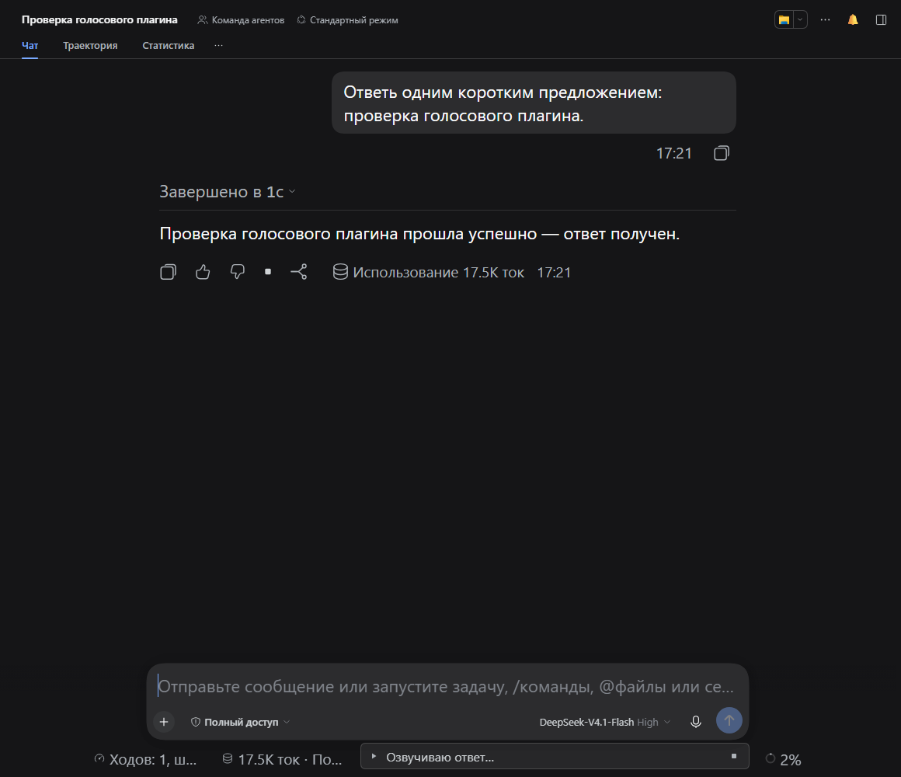
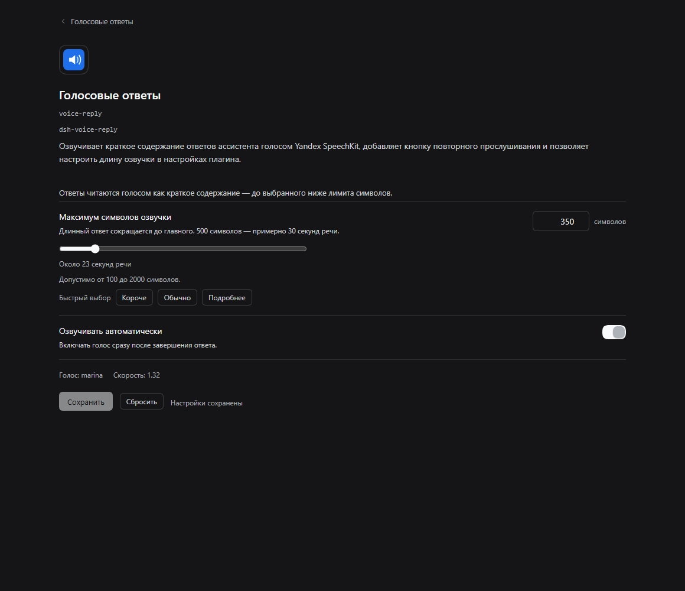

# dsh-voice-reply

Озвучивает готовые ответы ассистента в DSH Web голосом Yandex SpeechKit и добавляет к каждому ответу кнопку 🔊 для повторного прослушивания.

**Установка одной командой:**
`dsh plugin --profile web add dsh-voice-reply`

| | |
|---|---|
| **Платформа** | DSH Web, профиль `web` (проверено на Windows 11) |
| **DSH** | `>=0.2.2-rc.1 <0.3.0-0` |
| **Лицензия** | MIT |



## Зачем это

Агент работает несколько минут и выдаёт большой текстовый ответ. Хочется услышать результат, пока занимаешься другим делом, но копировать ответ в отдельный сервис озвучки долго, а встроенный синтез браузера звучит роботом. Плагин говорит голосом Яндекса сразу после завершения хода и даёт кнопку повтора у каждого ответа.

## Что делает

- Когда ход завершается, хост делает из ответа **краткое содержание** (локально, без обращения к модели), синтезирует его через **Yandex SpeechKit TTS**, а браузер проигрывает звук автоматически.
- Длина озвучки настраивается: по умолчанию **500 символов** (примерно 30 секунд речи), диапазон 100–2000. Длинный ответ сокращается до главных предложений, а не читается минутами.
- У каждого готового ответа появляется кнопка **🔊**: клик повторяет озвучку, повторный клик останавливает. Повтор берётся из кэша аудио на диске, поэтому не обращается к Яндексу заново и не тратит деньги.
- Пока идёт подготовка или проигрывание, над полем ввода виден компактный чип (например, «Озвучиваю краткое содержание…») с кнопкой остановки. Ошибки и блокировка автозапуска браузером показываются там же.
- **Settings → General → «Озвучивать ответы голосом»** — выключатель `autoSpeak`. Отдельная страница настроек плагина (**Плагины → Голосовые ответы**) меняет лимит символов озвучки и `autoSpeak`; голос и скорость показаны там же и задаются в конфиге плагина.
- История не перечитывается: озвучиваются только ответы, завершённые после установки плагина, и только новые ходы запускают автопроигрывание; кнопка 🔊 работает на любом ответе.
- Плагин **не слушает микрофон**, не распознаёт речь и не отправляет чат никуда, кроме короткого текста, который сам синтезирует.

## Установка

```sh
dsh plugin --profile web add dsh-voice-reply
```

Затем перезапустите `dsh web` (UI-плагины профиля загружаются при старте) и откройте адрес, который он напечатает. Строка плагина добавляется через `cordis.patch.yml` — править профиль вручную не нужно.

## Требования

- DSH `>=0.2.2-rc.1`, профиль `web`, Node.js `>=24.9.0` (требование самого DSH);
- аккаунт **Yandex Cloud**: сервисному аккаунту нужна роль **`ai.speechkit-tts.user`** на каталог и **API-ключ со скоупом `yc.ai.speechkitTts.execute`** (либо IAM-токен и id каталога);
- исходящий HTTPS к `tts.api.cloud.yandex.net`;
- браузер, который умеет проигрывать звук (первый автозапуск может потребовать одного действия на странице из-за политики autoplay).

## Настройка

| Поле | По умолчанию | Смысл |
|---|---|---|
| `enabled` | `true` | Главный выключатель плагина |
| `autoSpeak` | `true` | Автоматически озвучивать новые ответы (Settings → General и страница настроек плагина) |
| `summaryMaxChars` | `500` | Максимум символов озвучки (100–2000, шаг 50) |
| `maxChars` | `4000` | Старый жёсткий лимит исходного ответа до сокращения |
| `voice` | `marina` | Голос Yandex TTS v1 (список ниже) |
| `emotion` | `''` | Необязательная окраска для русского: `neutral`, `good`, `evil`, `friendly`, `whisper` (зависит от голоса) |
| `speed` | `1.32` | Скорость речи 0.1–3.0 |
| `format` | `mp3` | `mp3`, `oggopus` или `lpcm` |
| `debug` | `true` | Оставлено для совместимости: эта сборка пишет `.state/events.log` всегда (только счётчики, тайминги и коды) |
| `endpoint` | `https://tts.api.cloud.yandex.net/speech/v1/tts:synthesize` | Адрес SpeechKit TTS |

Тумблер в Settings → General и страница настроек плагина сохраняют значения через хост (`POST /dsh-voice-reply/preferences`) и применяются сразу, без правки профиля и перезапуска `dsh web`.



Настройки можно задать и в блоке `config` строки плагина:

```yaml
- id: voice-reply
  name: dsh-voice-reply
  config:
    voice: marina
    summaryMaxChars: 500
```

### Ключ доступа

Ключ **не** хранится в репозитории. Поддерживаются два локальных источника, и переменные окружения приоритетнее файла:

| Переменная | Смысл |
|---|---|
| `YANDEX_TTS_API_KEY` | API-ключ SpeechKit (режим сервисного аккаунта) |
| `YANDEX_TTS_IAM_TOKEN` | IAM-токен (режим IAM; нужен id каталога) |
| `YANDEX_TTS_FOLDER_ID` | Id каталога для режима IAM |

Либо те же поля в локальном `plugin-config.json` рядом с плагином (скопируйте `plugin-config.example.json`). Хост **перечитывает этот файл на каждый запрос**, поэтому замена ключа не требует перезапуска `dsh web`; переменные окружения читаются запущенным процессом и меняются только с перезапуском.

Как получить ключ в [консоли Yandex Cloud](https://console.yandex.cloud):

1. Выдайте сервисному аккаунту роль **`ai.speechkit-tts.user`** на каталог.
2. Создайте для него **API-ключ** со скоупом **`yc.ai.speechkitTts.execute`** (или оставьте скоуп пустым — тогда ключ наследует права аккаунта).
3. Впишите ключ в `YANDEX_TTS_API_KEY` или `plugin-config.json`.

Ключ, созданный только для распознавания речи (`yc.ai.speechkitStt.execute`), синтез отклоняет с `401 UNAUTHORIZED` / `Permission denied` — нужен ключ со скоупом TTS. После выдачи роли Яндексу может понадобиться несколько минут на распространение прав; единичный `401` сразу после изменения — нормально.

## Как это устроено

```text
ход завершён (reason = completed)
      │
      ├─ хост: запоминает готовый ответ этого чата (один ожидающий ответ)
      │
      └─ браузер (только когда чат в фокусе):
            забирает ответ один раз → POST /dsh-voice-reply/speak
                 │  хост: локальное краткое содержание (≤ summaryMaxChars)
                 │        → Yandex SpeechKit TTS v1 (последовательные куски)
                 │        → аудио в кэше на диске по voice|emotion|speed|format|lang|text
                 └─ <audio> играет по очереди; 🔊 повторяет из кэша
```

- Маршруты хоста: `GET /dsh-voice-reply/status`, `POST /dsh-voice-reply/speak`, `POST /dsh-voice-reply/preferences`, `GET /dsh-voice-reply/audio/<file>`; хранилище «один ответ на чат» — отдельная строка плагина (`dsh-voice-reply/pending`, маршруты `/dsh-voice-pending`).
- Ожидающий ответ забирается атомарно: переключение чатов, перезагрузка страницы и вторая вкладка не запускают один и тот же ответ дважды.
- Длинный текст режется на куски с учётом лимитов SpeechKit в 5000 символов и 15 КБ URL-кодированного тела (кириллица при кодировании расширяется примерно в 6 раз).
- `429`/`5xx`/таймауты повторяются с паузой; `400`/`401`/`403` не повторяются и показываются с подсказкой.
- Автозапуск откладывается, пока вкладка скрыта или не в фокусе, и начинается при возврате в этот чат — плагин не говорит в фоне.

## Ограничения

- **Платная услуга.** Yandex SpeechKit TTS тарифицируется Yandex Cloud за каждый не кэшированный синтез. Сам плагин бесплатный, повторное прослушивание из кэша денег не тратит.
- **Это краткое содержание, а не полный ответ.** Озвучиваются только ключевые предложения (по умолчанию 500 символов, 100–2000). Код, таблицы и ссылки пропускаются; полный текст остаётся на экране.
- Только голоса **API v1** — `alena`, `filipp`, `ermil`, `jane`, `omazh`, `zahar`, `marina`, `madi_ru`, `amira`, `madi`, `nigora`, `john`, `lea`. Голоса v3 (`dasha`, `julia`, `lera`, `masha`, …) и SSML v3 через этот API недоступны.
- Политика автозапуска браузера может заблокировать первое автоматическое проигрывание до действия на странице; чип попросит нажать 🔊.
- История автоматически не перечитывается; у ответов, завершённых до установки плагина, нет записи на хосте — они звучат только по кнопке 🔊.
- Синтез идёт последовательно (один запрос за раз), поэтому перед первым звуком длинного содержания возможна пауза в несколько секунд.
- Плагин читает текст ответа, но не записывает аудио, не переводит и не распознаёт речь.

## Безопасность

- Хост делает HTTPS-запросы **только к настроенному адресу SpeechKit** (по умолчанию `https://tts.api.cloud.yandex.net/speech/v1/tts:synthesize`). Телеметрии, аналитики, внешнего логирования и других исходящих хостов нет.
- API-ключ/IAM-токен остаётся в процессе хоста: он не передаётся в браузер, не попадает в журналы и не включается в npm-пакет. В пакете есть только `plugin-config.example.json` с пустыми полями.
- Краткое содержание считается локально, без вызова модели. В Яндекс уходит только этот короткий текст для синтеза; остальной ответ остаётся на вашей машине.
- `.state/events.log` содержит только количество символов, тайминги и коды статусов — без текста ответов и секретов.
- Аудио кэшируется во временной папке ОС (`dsh-voice-reply-cache`), а не в репозитории.
- `plugin-config.json` добавлен в `.gitignore`; держите его локально.

## Удаление

```sh
dsh plugin --profile web remove dsh-voice-reply
```

Кэш аудио во временной папке ОС (`dsh-voice-reply-cache`) и `.state/events.log` в папке плагина остаются на диске; удалите их вручную, если нужна полная очистка.

## Разработка

У рантайма нет зависимостей и шага сборки. Локальные тесты (без сети, с мок-сервером SpeechKit и VM для браузерной половины):

```sh
node test/yandex-tts.test.mjs     # движок TTS и обработка текста
node test/summarize.test.mjs      # экстрактивное краткое содержание и его лимит
node test/host-api.test.mjs       # HTTP-API против мок-сервера Яндекса
node test/host-pending.test.mjs   # хранилище «один ответ на чат»
node test/client-static.mjs       # браузерный модуль в VM, без Chrome
npm pack --dry-run                # состав публикуемого пакета
```

Скрипты `test/e2e-*.mjs` требуют Chrome и запущенного `dsh web`; в пакет они не входят. `test/e2e-plugin-settings.mjs` дополнительно проверяет страницу настроек плагина и то, что длинный ответ уходит в TTS уже сокращённым (через локальный мок).

## Лицензия

MIT — см. [LICENSE](LICENSE).
